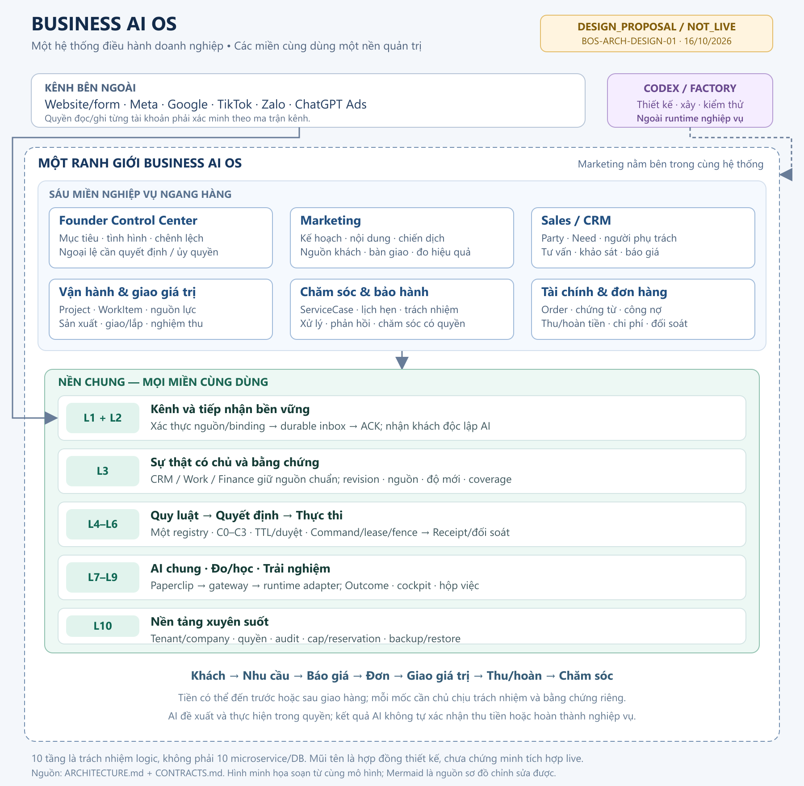

# Business AI OS — Gói thiết kế tổng thể BOS-ARCH-DESIGN-01

Ngày 16/10/2026, Asia/Ho_Chi_Minh. Phiên bản gói 0.1.0. **DESIGN_COMPLETE: A01–A12 đạt về thiết kế**; kết quả review cuối ở [EVIDENCE](EVIDENCE.md). Các lựa chọn mới là PROPOSED, không phải APPROVED V3.2, quyền setup hoặc nghiệm thu hệ đang chạy.

## 1. Kết quả thiết kế

Một Business AI OS bao gồm sáu miền: Founder Control Center, Marketing, Sales/CRM, Vận hành & giao giá trị, Chăm sóc & bảo hành, Tài chính & đơn hàng. Marketing ở bên trong cùng boundary và nhận phản hồi từ Sales, đơn, thu/hoàn tiền, dự án và dịch vụ. Sáu Hệ là vòng quản trị dùng chung; L1–L10 là các trách nhiệm kỹ thuật, không phải mười service/DB.

Tận dụng repo Quanlycongviec: CRM/Work/Order/Finance có façade một writer, inbox/outbox/adapters và giao diện hiện hữu được harden từng lát. Business OS giữ quyền/luật/quyết định/thực thi/receipt/cap; Paperclip tổ chức việc AI. Runtime qua adapter có thể thay; Codex nằm ngoài runtime, làm công việc kỹ thuật theo nhiệm vụ. n8n là tùy chọn có điều kiện cho tích hợp ngoại vi, không giữ đường ghi vượt service.

## 2. Bộ bàn giao và thứ tự đọc

| Tệp | Nội dung đủ giao người xây |
|---|---|
| [ARCHITECTURE](ARCHITECTURE.md) | mục tiêu/chủ/field writer, vào–ra/state/KPI/ngoại lệ của cả sáu miền; L1–L10, sáu Hệ và topology/dev/staging/production dự kiến |
| [CONTRACTS](CONTRACTS.md) | authority map, 16 contract IDs, endpoints đề xuất, auth/required inputs/results/errors, event/state/revision, Command/UNKNOWN/receipt/cap/callback, tiền và đo |
| [INVENTORY](INVENTORY.md) | hiện trạng source theo path/line/SHA, dùng lại/bổ sung/hoãn/thay, safe read local runtime và giới hạn |
| [CHANNELS](CHANNELS.md) | sáu phần Marketing và 16 dòng khả năng website/Meta/Google/TikTok/Zalo/ChatGPT Ads; tài khoản chưa chứng minh ghi UNVERIFIED |
| [DECISIONS](DECISIONS.md) | bảy mini-ADR PROPOSED, backend/worker so với n8n, license/chi phí có nguồn, authority/runtime/cap/tenant và trade-offs |
| [BACKLOG_ACCEPTANCE](BACKLOG_ACCEPTANCE.md) | P0–P5, B00–B12; trace A01–A12/I01–I12 đến contracts, T01–T20 V3.1 + T21–T32 mở rộng, evidence cần có và rollback |
| [RESOURCES](RESOURCES.md) | nhân lực, ROM có giả định, công thức TCO/rate UNPRICED, ngân sách Marketing130 triệu riêng và ledger không cộng trùng |
| [EVIDENCE](EVIDENCE.md) | nguồn/hash, code khác live, missing references, kiểm thiết kế và review thực đã chạy |
| [diagrams](diagrams/README.md) | tổng thể PNG/SVG và chín nguồn Mermaid gồm ERD/technical/deployment/năm sequence chính |
| [schemas](schemas/bos-contracts.schema.json), [fixtures](examples/design-fixtures.json), [request/response/event](examples/contract-exchange.json), [checks](checks/README.md) | 36 schema definitions, 30 record tổng hợp, state graph và 12 kiểm thiết kế offline; không là backend đã xây |

16 contracts: C-QUERY, C-INGEST, C-FACT, C-CONSENT, C-HANDOFF, C-CONTENT, C-CAMPAIGN, C-ACTION, C-COMMAND, C-RECEIPT, C-AI, C-BUDGET, C-PAYMENT, C-PROJECT, C-SERVICE, C-OUTCOME.

## 3. Đã thấy và phần còn phải xây

| Phần | Kết luận trong phạm vi thiết kế |
|---|---|
| Express/React/PostgreSQL/Render, CRM, công việc xưởng/giao lắp, đơn và thu tiền | CODE_SEEN; dùng lại có adapter/quyền/authority; không suy toàn bộ đã nghiệm thu |
| Website intake/receipt/consent, Facebook signed inbox, Google CSV export | có mã và hồ sơ lịch sử; nguồn/dữ liệu thật/provider quyền và readiness phải xác minh theo từng luồng |
| Paperclip local | safe health read xác nhận đang chạy2026.1005.0; không chứng minh AI giao–kiểm–sửa/business receipt hoặc restore đạt |
| OpenClaw và controller/timer hiện có | có runtime/timers được đọc; giữ dependency/lịch đến nhiệm vụ chuyển đổi riêng, không coi33 agent lịch sử là roster hiện tại |
| Scope khách và legacy tenant path | cần hardening trước khả năng BOS ghi; thiếu tenant không mở quyền, lookup phone không tự link chéo công ty |
| Tiền và nguồn chuẩn | có nhiều đường ghi/mirror; chọn façade authority theo transaction trước cutover, không thêm sổ tiền cạnh tranh |
| Policy/Decision/Command/cap chung | chưa có bằng chứng lõi chung đủ bất biến; cần hoàn thiện version/snapshot/atomic reserve/fence/UNKNOWN và pure receipt |
| Content/Campaign/Consent registry, ServiceCase và Outcome liên miền | hợp đồng thiết kế đã có, cần adapters/registry tối thiểu đúng owner; không dựng ERP/BI tổng quát |

Hai PNG tham chiếu và setup brief V3.1 chưa tìm thấy trong phạm vi đã kiểm. Đã dùng brief hiện hành cùng PDF V3.1 có sẵn để thiết kế các phần độc lập; tác động/điều cần đối chiếu lại ở EVIDENCE. Không nhận đã tiếp quản hay dừng một job khác.

## 4. Quyết định kỹ thuật đề xuất

1. Giữ modular backend và worker bền vững làm xương sống pilot. n8n chỉ thêm khi một workflow cụ thể giảm tổng công, có maintainer/license/callback/restore và không bypass Business OS; không cài/gỡ n8n ở đây.
2. Giữ dữ liệu có chủ theo field. CRM giữ Party/Need; Work giữ sau bán; Finance giữ tiền có chứng từ. L3 là hợp đồng/projection có nguồn, không DB kinh doanh thứ hai.
3. Một Rule/Approval registry, bốn cửa Pháp–Lệ–Lý–Tình, C0–C3. Hard-deny/sai scope là REJECTED; L6 recheck ngay trước effect.
4. L10 sở hữu ledger cap; mỗi model attempt/reviewer/retry reserve trước gọi. Quota Paperclip là giới hạn con; usage UNKNOWN giữ hold; chuyển cap owner có freeze/đối soát, chưa thực hiện.
5. Stage build: scope/authority/receiver trước, một thin slice Marketing–Sales sau; quote–cash, Project và ServiceCase có contracts/backlog ngay trong gói, xây nối tiếp theo nguồn sẵn sàng.

## 5. Gói xây đầu tiên đề xuất giao tiếp

Mở một nhiệm vụ xây riêng cho B00/B01 và phần hữu hạn B02/B03: baseline quyền/schema/source thật; tenantA/A1/A2 và B/B1 fixtures; scoped Party/Need façade; một form và một native source; durable ACK/dedup; handoff có người nhận và bốn mốc; một Command thử trong staging với receipt pure-read, fence/UNKNOWN và outbound sink.

Nguồn lực: technical lead/backend PostgreSQL, BA/CRM owner, QA độc lập, DevOps theo phần staging/restore; Finance tham gia chốt authority tiền/budget. Backlog có ROM từng việc; B00–B11 cộng66–117 ngày công theo giả định, không phải lịch cần làm hết trước pilot. Rate/host/AI thực tế UNPRICED, AI cap UNSET thì fixture thay paid call. Nguồn lực/chi phí sản phẩm tách khỏi130 triệu Marketing.

Gate bàn giao xây: hợp đồng và fixture được review, đúng source ownership, nhiệm vụ xây có môi trường/owner/phạm vi/quyền và số cap rõ. Gate mở luồng thật cần các T liên quan đạt, readback/restore/rollback và quyết định phát hành riêng. Không tạo dữ liệu thử hoặc migration trên hệ thật trong gói thiết kế.

## 6. Những quyết định thực sự cần chốt trước phần phụ thuộc

| Quyết định | Người có thẩm quyền / tác động |
|---|---|
| Mapping tenant/company thật và quyền giao dịch liên công ty | Founder/đại diện hợp đồng; thiết kế hỗ trợ cả cùng/khác tenant, chưa hardcode VPT/Phúc Đạt |
| Authority thu tiền và owner nghiệp vụ; policy giá/bảo hành/ghi nhận doanh thu/SLA | chủ Sales/Finance/Operations được giao; không suy từ bảng mirror hoặc AI |
| Kỳ/basis thuế-phí của130 triệu; cap sản phẩm/AI, staffing/rate và provider/data scope | Founder/Finance/product owner; thiết kế không chi hoặc phân bổ lại |
| Hạ tầng staging, đầu mối sự cố và mục tiêu RPO/RTO/SLO | owner vận hành; số đạt phải đo sau, không hứa HA |
| Chọn workflow n8n bổ sung nếu thật sự có lợi | technical lead theo tiêu chí P02; làm rõ license/use case trước mua/cung cấp dịch vụ, không cần Founder duyệt từng node |

Đây là đầu vào để mở gói xây tương ứng; không phải danh sách việc nhỏ xin duyệt lại. Các giả định thiếu đã có phương án/contract/ca thử và ảnh hưởng để review, không dùng giả định làm credential, consent, tiền hoặc quyền vận hành.
