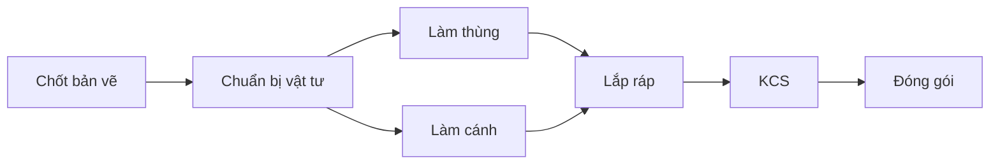

# Thiết kế quy trình sản xuất linh hoạt và dự án mẫu

Ngày: 14/10/2026. Trạng thái: **DRAFT để anh Hùng duyệt thiết kế**.
Anh đã đồng ý thực hiện bản thiết kế; chưa coi là phê duyệt triển khai, migration hoặc phát hành. Tài liệu này không thay đổi hệ thống đang chạy.

## 1. Mục tiêu đã chốt từ trao đổi

Một dự án gồm nhiều công đoạn, mỗi công đoạn gồm nhiều nhiệm vụ. Tủ bếp, cánh kính và các loại khác dùng cùng cơ chế, nhưng khác cấu trúc và thời gian. **7 ngày chỉ là ví dụ**, không phải quy tắc toàn hệ thống.

Người lập kế hoạch tự tạo/điều chỉnh quy trình dự án; hệ thống tính ngược hạn nhiệm vụ. Nhân viên biết việc cần làm trước và việc phải chờ; quản lý biết việc trễ, người phụ trách và ảnh hưởng. Dự án phù hợp có thể lưu thành mẫu cho lần sau.

## 2. Phần hiện có được tái sử dụng

| Nguồn mã/schema | Khả năng hiện tại | Hướng thiết kế |
|---|---|---|
| production_pipeline_stages, workshop_project_types | Pipeline theo công ty/phân loại, nhóm song song, SLA | Là nguồn nhập mẫu ban đầu; không dùng cột chung làm cấu trúc duy nhất của dự án mới |
| workshop_task_templates/items; SQL 55, 249, 295 | Bộ nhiệm vụ theo công đoạn/phân loại | Có thể nhập vào mẫu quy trình mới, kiểm tra ánh xạ trước khi lưu |
| projects, tasks, crm_tasks; projectOrderFulfillment.js | Dự án và hai nguồn nhiệm vụ hiện hành | Giữ tương thích dự án cũ; dự án quy trình mới cần một nguồn nhiệm vụ chuẩn |
| sxWorkshopSchedule.js | Tính lịch nhóm planning/cabinet/finishing/packing | Thay bằng tính lịch từ cấu trúc riêng cho dự án mới; không đổi ngầm dự án cũ |
| sxInstallPlanKanbanDeadline.js | Hạn thẻ SX theo ngày lắp | Giữ hạn dự án riêng; hạn nhiệm vụ được tính độc lập |
| projectOrderFulfillment.js: scheduleNextSxCrmTaskAfterComplete | Tuyến SX hiện bỏ tự gán hạn; nhiệm vụ sinh với deadline null | Bổ sung lập và chốt lịch có kiểm chứng |
| PR #131 | Candidate kiểm nhiệm vụ bắt buộc trước khi xác nhận công đoạn Xong | Tái sử dụng nguyên tắc, không giả định PR đã triển khai |

Hiện chưa thấy cơ chế hoàn chỉnh lưu toàn bộ dự án thành phiên bản mẫu độc lập hoặc đồ thị phụ thuộc nhiệm vụ. Tài liệu HCB_TU_BEP_DEADLINE_GROUP.md là mô tả quy trình mẫu lịch sử; không áp công thức đó cho mọi loại sản xuất.

## 3. Luồng người dùng

**Tạo dự án → Chọn mẫu hoặc Tạo mới → Điều chỉnh quy trình → Xem trước lịch → Chốt kế hoạch → Thực hiện → Lưu thành mẫu.**

### Màn hình tạo và điều chỉnh

- Nhập tên, loại sản xuất, hạn hoàn thành SX, lịch làm việc và ngày sớm nhất có thể bắt đầu. Ngày giao/lắp là mốc khác; có thể cấu hình khoảng chuẩn bị giao để suy hạn SX.
- Chọn phiên bản mẫu theo công ty/phân loại, hoặc bắt đầu từ quy trình trống.
- Công đoạn thêm/bớt/đổi tên/sắp thứ tự được trong chính dự án. Không sửa pipeline chung khi chỉ chỉnh một dự án.
- Mỗi nhiệm vụ có tên, thời lượng, vai trò/nhân viên, bắt buộc hay tùy chọn, nhiệm vụ phải xong trước và checklist/minh chứng.
- Nút **Làm sau…** chọn một hoặc nhiều nhiệm vụ tiền nhiệm. Những việc không phụ thuộc nhau có thể song song. Kéo thứ tự hiển thị không tự tạo quan hệ phụ thuộc.
- Nút **Tính lịch** hiển thị ngày bắt đầu, hạn chót, việc chưa giao người, xung đột và khả năng kịp hạn. Chưa chốt thì chưa tạo thông báo giao việc.

### Màn hình nhân viên

Các nhóm: **Trễ hạn / Cần làm hôm nay / Sắp tới / Đang chờ / Đã xong**. Mỗi việc có hạn, người nhận, tiền nhiệm và lý do đang chờ. Bấm Bắt đầu hoặc Hoàn thành trên nhiệm vụ; không dùng chuyển thẻ để thay cho hoàn thành.

Ưu tiên: việc quá hạn và ảnh hưởng hạn dự án trước, sau đó việc sẵn sàng có hạn gần nhất. Việc chưa đến ngày có thể bắt đầu sớm khi mọi tiền nhiệm đã xong. Việc bị chặn vẫn hiển thị, không đưa vào danh sách sẵn sàng. Người dùng xem được danh sách và lịch/Gantt từ cùng nguồn dữ liệu.

### Màn hình quản lý

Theo từng dự án: hạn cam kết, dự báo hoàn thành, công đoạn, nhiệm vụ trễ, nhiệm vụ chưa giao, nguyên nhân chờ và người phụ trách. Mở từ công đoạn xuống nhiệm vụ cụ thể. Phân biệt **trễ nhiệm vụ**, **trễ công đoạn**, **nguy cơ trễ toàn dự án**; không gom thành một con số quá hạn theo ngày lắp.

## 4. Quy tắc tính lịch đề xuất

### Đơn vị và lịch

Đề xuất bản đầu dùng thời lượng theo **giờ làm việc**, nhập được dạng ngày/giờ. Một ngày tương đương số giờ theo ca được cấu hình; không mặc định mọi xưởng cùng 8 giờ. Múi giờ Asia/Saigon; mỗi kế hoạch giữ bản sao lịch ca, ngày nghỉ/lễ tại thời điểm chốt. Ví dụ phía dưới dùng ngày làm việc để dễ đọc.

Chưa có lịch hoặc thời lượng thì báo thiếu thông tin, không tự gán 7 ngày. Thời gian chờ nhà cung cấp có thể là giờ/ngày lịch, phải được khai rõ; không coi thời gian chờ là lao động tại xưởng.

### Phụ thuộc và tính ngược

Bản đầu chỉ hỗ trợ **xong việc trước mới bắt đầu việc sau**. Một việc có thể có nhiều tiền nhiệm. Cấm tự phụ thuộc, phụ thuộc vòng và tham chiếu việc ngoài kế hoạch. Công đoạn dùng để nhóm nhiệm vụ; quan hệ cụ thể đặt trên nhiệm vụ hoặc mốc kết thúc công đoạn, không tạo hai lịch mâu thuẫn.

Từ mốc hoàn thành SX, duyệt đồ thị từ cuối về đầu:

1. Việc cuối có hạn chót bằng mốc hoàn thành, trừ khoảng đệm cuối nếu có.
2. Hạn chót của một việc bằng **mốc bắt đầu sớm nhất trong các việc nối tiếp**, trừ khoảng chờ/đệm đã cấu hình.
3. Ngày bắt đầu = lùi thời lượng qua các khung làm việc hợp lệ.
4. Các nhánh song song tính riêng, chỉ nhập lại khi tất cả tiền nhiệm cần thiết kết thúc. Không cộng thời lượng hai nhánh song song như làm nối tiếp.
5. Hạn công đoạn là hạn muộn nhất của nhiệm vụ đang thuộc kế hoạch trong công đoạn; ngày bắt đầu là ngày sớm nhất. Các khoảng thời gian có thể chồng nhau nếu quan hệ cho phép.
6. Tính xuôi từ ngày sớm nhất có thể bắt đầu để kiểm khả thi. Nếu kết thúc sớm nhất vượt hạn cam kết, hiện thiếu bao nhiêu thời gian và nhánh gây thiếu; không âm thầm rút thời lượng.

**Không bắt buộc tổng thời lượng = số ngày cam kết.** Dự án có thể có khoảng dư. Khi hai việc trùng lịch cùng một nhân viên/máy, cảnh báo năng lực; bản đầu chưa tự tối ưu lịch nguồn lực và không được coi lịch phụ thuộc là chứng minh xưởng đủ năng lực.

### Kế hoạch đã chốt và độ trễ

Giữ riêng lịch kế hoạch đã chốt và dự báo theo thực tế. Nhiệm vụ chưa kết thúc và thời điểm hiện tại lớn hơn hạn kế hoạch thì trễ, kể cả đang chờ tiền nhiệm. Nhiệm vụ hoàn thành sau hạn giữ nhãn hoàn thành trễ; không mất dấu trễ khi bấm Xong.

Hoàn thành sớm mở điều kiện cho việc sau, không tự sửa lịch cam kết. Đổi ngày giao/thời lượng/phụ thuộc tạo bản đề xuất lịch mới với bảng trước–sau, lý do và ảnh hưởng; quản lý duyệt mới chốt phiên bản mới. Không xóa lịch cũ, không sửa mốc thực tế, không tự kéo hạn để hết cảnh báo.

## 5. Hoàn thành và ngoại lệ

- Hoàn thành nhiệm vụ: server kiểm quyền, trạng thái tiền nhiệm và minh chứng bắt buộc; lưu người/thời điểm. Checklist chỉ là việc con, không tự tạo một nhiệm vụ giao việc thứ hai.
- Công đoạn Xong khi mọi nhiệm vụ bắt buộc trong công đoạn đã xong; nhiệm vụ tùy chọn còn mở vẫn hiện riêng.
- Đề xuất dự án hoàn thành SX khi các nhiệm vụ bắt buộc và mốc bàn giao SX đã xong. Thu tiền/công nợ là trạng thái khác; không đồng nhất hoàn thành sản xuất với hoàn thành doanh thu.
- Bỏ một nhiệm vụ tùy chọn khỏi kế hoạch phải có lý do và tính lại lịch. Nhiệm vụ bắt buộc cần quản lý duyệt miễn trừ, không cho nhân viên tự hủy để lách điều kiện.
- Mở lại một nhiệm vụ cần ghi lý do; công đoạn/dự án không còn đủ điều kiện Xong phải hiển thị lại trạng thái hiệu lực. Nếu việc sau đã bắt đầu, cảnh báo ảnh hưởng; không tự xóa kết quả của việc sau.
- Hai nhân viên thao tác đồng thời: kiểm tra và ghi chuyển trạng thái trong một giao dịch, khóa/version kế hoạch; không chỉ kiểm frontend. Đây là yêu cầu triển khai mới, không chứng nhận gate đọc-trước-ghi của PR #131 đã đạt tính nguyên tử.

## 6. Mẫu và phiên bản

**Lưu thành mẫu** từ một dự án: lưu công đoạn, nhiệm vụ, thời lượng, vai trò, quan hệ, yêu cầu minh chứng, khoảng đệm và quy tắc lịch. Không lưu khách hàng, địa chỉ, giá/cọc/công nợ, ngày cụ thể, trạng thái Xong, thời điểm thực tế hoặc tệp riêng của khách.

Mẫu có công ty sở hữu, phân loại, tên và các phiên bản. Phiên bản nháp được sửa; phiên bản công bố là bất biến. **Cập nhật mẫu** tạo phiên bản mới, không viết đè bản đã dùng. Mẫu công bố chỉ người có quyền lập quy trình được tạo/chia sẻ trong công ty.

Khi tạo dự án: chọn đúng phiên bản rồi sao chép thành cấu trúc riêng, sinh ID mới và ánh xạ lại các quan hệ. Mẫu dùng vai trò; dự án mới gán nhân viên thực tế, cảnh báo nếu chưa giao. Mọi nhiệm vụ mới chưa làm, dù dự án nguồn đã hoàn thành.

Đổi mẫu không tự tác động dự án đã chạy. Áp phiên bản mới vào dự án đang chạy là thao tác riêng: xem chênh lệch, bảo vệ việc đã làm, duyệt tác động trước khi áp. Bản đầu có thể chỉ cho đổi mẫu khi chưa chốt/chưa bắt đầu.

## 7. Hai ví dụ để kiểm chứng (số minh họa)

Thời lượng dưới đây là giả định để kiểm thuật toán, **không phải định mức sản xuất đã được xưởng xác nhận**. Các ngày đánh số là ngày làm việc, bỏ các ngày nghỉ theo lịch đã chọn.

### Mẫu tủ bếp — ví dụ 7 ngày làm việc

| ID | Công đoạn / nhiệm vụ | Thời lượng | Làm sau | Lịch minh họa |
|---|---|---|---|---|
| T1 | Thiết kế / Chốt bản vẽ | 1 ngày | — | Ngày 1 |
| T2 | Vật tư / Chuẩn bị vật tư | 1 ngày | T1 | Ngày 2 |
| T3 | Gia công / Làm thùng | 2 ngày | T2 | Ngày 3–4 |
| T4 | Gia công / Làm cánh | 2 ngày | T2 | Ngày 3–4 |
| T5 | Lắp ráp / Ghép thùng và cánh | 1 ngày | T3 và T4 | Ngày 5 |
| T6 | Kiểm tra / KCS sản phẩm | 1 ngày | T5 | Ngày 6 |
| T7 | Đóng gói / Chuẩn bị bàn giao | 1 ngày | T6 | Ngày 7 |

T3 và T4 chạy song song; tổng đường dài nhất là 1+1+2+1+1+1=7 ngày, không phải cộng tất cả thành 9 ngày. T4 trễ một ngày và không có thời gian dư thì dự báo T5 trở đi trễ; hạn kế hoạch ban đầu vẫn giữ.

### Mẫu cánh kính — ví dụ 6 ngày làm việc

| ID | Công đoạn / nhiệm vụ | Thời lượng | Làm sau | Lịch sớm nhất minh họa |
|---|---|---|---|---|
| K1 | Tiếp nhận / Chốt kích thước | 1 ngày | — | Ngày 1 |
| K2 | Gia công / Làm khung | 2 ngày | K1 | Ngày 2–3 |
| K3 | Gia công / Xử lý kính | 1 ngày | K1 | Ngày 2, có 1 ngày dư |
| K4 | Lắp ráp / Lắp kính vào khung | 1 ngày | K2 và K3 | Ngày 4 |
| K5 | Kiểm tra / KCS cánh | 1 ngày | K4 | Ngày 5 |
| K6 | Đóng gói / Bàn giao | 1 ngày | K5 | Ngày 6 |

Khi tính ngược lịch muộn nhất, K3 có thể đặt ngày 3 để kết thúc cùng K2; không bắt buộc tất cả việc bắt đầu sớm nhất. Màn hình hiển thị lịch đã chốt và khoảng dư để ưu tiên đúng. Mẫu này không sinh việc làm thùng tủ.

## 8. Cấu trúc dữ liệu và API đề xuất (chưa triển khai)

| Thực thể đề xuất | Nội dung |
|---|---|
| Mẫu quy trình + phiên bản | Chủ sở hữu, phân loại, cấu trúc bất biến khi công bố |
| Kế hoạch riêng của dự án + phiên bản lịch | project_id, phiên bản mẫu nguồn, calendar snapshot, hạn cam kết, trạng thái nháp/chốt |
| Công đoạn dự án | ID riêng, tên, thứ tự hiển thị, vai trò, ánh xạ pipeline cũ nếu có |
| Nhiệm vụ kế hoạch | stage_id riêng, thời lượng/đơn vị, bắt buộc, vai trò/assignee, lịch kế hoạch, thực tế |
| Quan hệ phụ thuộc | ID hai nhiệm vụ, kiểu finish-to-start, khoảng chờ/đệm |
| Nhật ký thay đổi | Người/lý do, phiên bản trước–sau, miễn trừ, mở lại, quyết định chốt |

Với dự án dùng quy trình mới, có một nhiệm vụ thực thi chuẩn thuộc sau bán/Work Unified. Chọn bảng tasks hiện có hay bảng execution mới phải được xác nhận khi rà schema/quyền; không tự tạo thêm bản sao crm_tasks chỉ để phù hợp màn hình cũ. Adapter trả cùng trạng thái/hạn cho màn hình SX, công việc cá nhân, báo cáo và liên kết CRM. CRM vẫn giữ việc trước bán.

Các command dự kiến: tạo kế hoạch từ mẫu; sửa bản nháp với expected_version; preview lịch; chốt lịch; bắt đầu/hoàn thành/mở lại nhiệm vụ; lưu dự án thành phiên bản mẫu nháp; công bố phiên bản mẫu. Các read: cấu trúc kế hoạch, việc sẵn sàng/đang chờ, quá hạn, dự báo ảnh hưởng. Backend kiểm quyền công ty, dự án và từng nhiệm vụ; không chỉ dựa vào IDs do client gửi. Các command tạo/chốt cần idempotency và transaction.

## 9. Chia chặng triển khai sau khi duyệt

1. **Cấu trúc riêng + mẫu phiên bản:** tạo mới/từ mẫu, chỉnh quy trình, lưu mẫu; không thay dự án cũ.
2. **Bộ tính lịch:** lịch làm việc, đồ thị, tính ngược/xuôi, preview/chốt, kiểm vòng và không đủ thời gian.
3. **Thực thi và báo cáo:** danh sách ưu tiên/chờ, hoàn thành có kiểm chứng, cảnh báo trễ và ảnh hưởng; cùng nguồn đọc.
4. **Thử hai mẫu:** kiểm giao diện và API trong staging với dữ liệu giả; đối chiếu định mức với xưởng.
5. **Chuyển đổi tự chọn:** nhập cấu trúc cũ vào bản nháp, quản lý duyệt ánh xạ/lịch rồi mới chuyển từng dự án. Không backfill toàn bộ dự án đang chạy tự động.

Mỗi chặng có PR, kiểm tenant/quyền, migration mới nếu cần, rollback và nghiệm thu riêng. Trước khi bật cần xác nhận schema/nguồn chuẩn thực thi; không dùng bản thiết kế này làm quyền ghi DB hoặc deploy.

## 10. Tiêu chí nghiệm thu

- Hai loại sản xuất có số công đoạn/nhiệm vụ khác nhau, không dùng thời lượng 7 ngày cố định.
- Sửa cấu trúc riêng một dự án không làm thay đổi mẫu hoặc dự án khác.
- Mẫu phiên bản mới không làm đổi dự án đã tạo; sao chép không mang PII/ngày/trạng thái thực tế.
- Ví dụ tủ bếp dài 7 ngày, cánh kính dài 6 ngày theo đường phụ thuộc, không cộng hai nhánh song song.
- Ngày nghỉ/ca làm và thời gian chờ lịch được tính đúng; lịch FE/BE dùng cùng kết quả backend.
- Vòng phụ thuộc, thiếu thời lượng, thiếu vai trò hoặc lịch không đủ đều được chỉ rõ.
- Nhân viên thấy việc sẵn sàng đúng thứ tự; quản lý mở được nhiệm vụ trễ và người phụ trách.
- Hoàn thành trễ/mở lại vẫn giữ lịch sử; đổi hạn tạo phiên bản mới, không xóa cảnh báo của kế hoạch cũ.
- Không lách bằng ID công ty khác, danh sách đang lọc, hủy việc bắt buộc hoặc hai thao tác đồng thời.
- Dự án cũ tiếp tục vận hành; có thể dừng tính năng mới mà không mất nhiệm vụ/lịch sử.

## 11. Những lựa chọn cần anh duyệt cùng thiết kế

Đề xuất: dùng giờ làm việc theo ca; mốc tính là hạn hoàn thành SX (ngày giao/lắp tách riêng); quan hệ finish-to-start cho bản đầu; lập/chốt và công bố mẫu do quản lý; nhân viên chỉ cập nhật nhiệm vụ được giao; miễn trừ việc bắt buộc cần quản lý; có cảnh báo trùng người/máy nhưng chưa tự tối ưu năng lực. Các lựa chọn này chưa được anh phê duyệt chỉ bằng việc đồng ý làm bản thiết kế.
