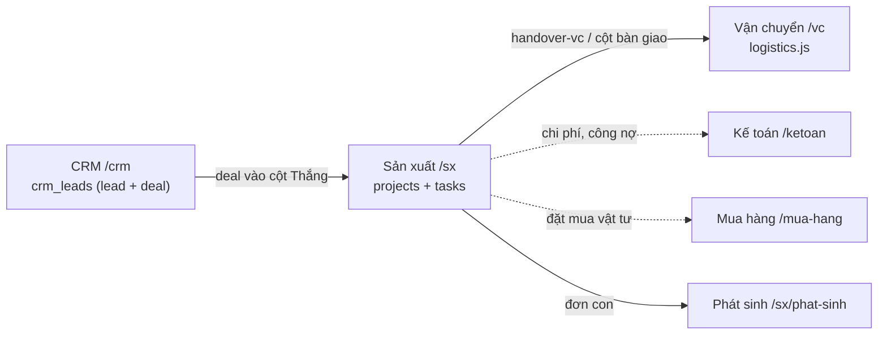
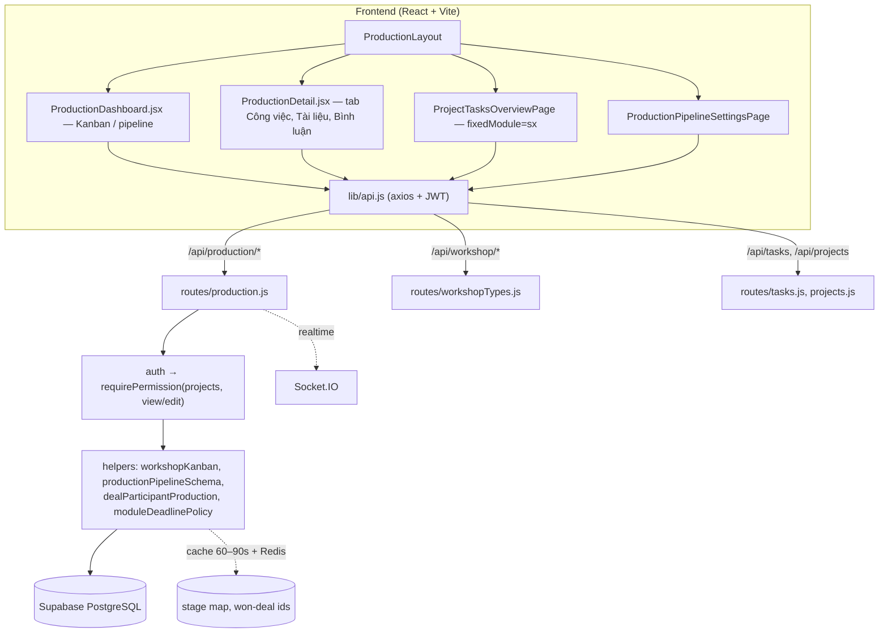
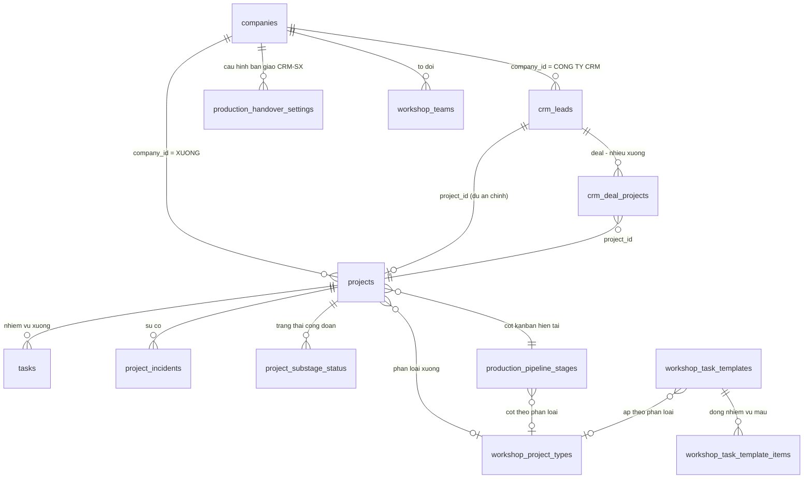
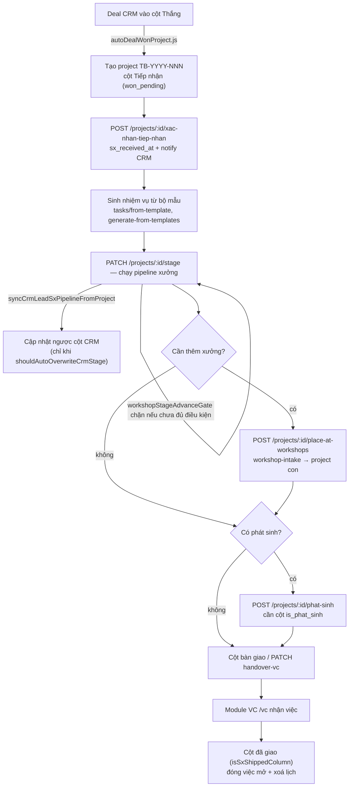
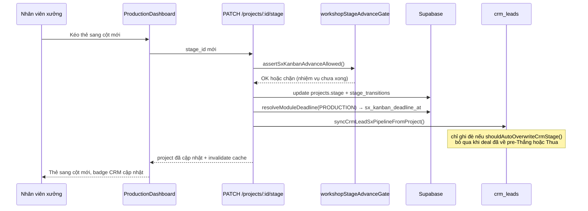
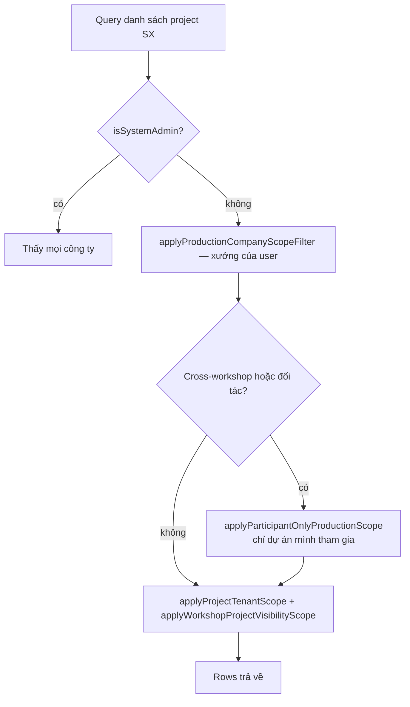

# Instruction — Module Sản xuất (SX)

Hướng dẫn cho AI / dev khi sửa module Sản xuất. Đọc file này trước khi mở code.
Liên quan: [`CLAUDE.md`](../../CLAUDE.md), [`docs/ba/HUONG_DAN_CHUYEN_DEAL_SX.md`](../ba/HUONG_DAN_CHUYEN_DEAL_SX.md),
[`docs/khoa-hoc/module-san-xuat-DRAFT.md`](../khoa-hoc/module-san-xuat-DRAFT.md) (giáo trình người dùng).

## 1. Phạm vi

Module SX quản lý dự án xưởng sau khi deal CRM Thắng: tiếp nhận → sản xuất → giao →
lắp đặt → bàn giao VC. Module Vận chuyển (`/vc`, `routes/logistics.js`) là module song sinh,
dùng chung layout, pipeline-settings, task-templates — sửa SX thì kiểm tra VC có vỡ không.



## 2. Bản đồ file

| Lớp | Đường dẫn | Ghi chú |
|---|---|---|
| API chính | `backend/src/routes/production.js` (~7.000 dòng) | mount `/api/production` |
| API phân loại xưởng | `backend/src/routes/workshopTypes.js` | mount `/api/workshop` |
| API tổ/đội | `backend/src/routes/workshopTeams.js` | mount `/api/workshop-teams` |
| API nhiệm vụ | `backend/src/routes/tasks.js`, `routes/projects.js` | nhiệm vụ SX nằm ở bảng `tasks` |
| Kanban/scope | `backend/src/helpers/workshopKanban.js` | cột, trạng thái, sync CRM |
| Schema pipeline | `backend/src/helpers/productionPipelineSchema.js` | fallback khi DB thiếu cột |
| Deadline | `backend/src/helpers/moduleDeadlinePolicy.js`, `sxCardPlanDeadline.js` | |
| Đặt xưởng (multi-SX) | `placeProjectAtWorkshops.js`, `createWorkshopIntake.js` | |
| Phát sinh | `sxPhatSinhOrder.js`, `sxPhatSinhDeadline.js` | |
| Phân quyền theo xưởng | `dealParticipantProduction.js`, `workshopCompanyScope.js` | |
| FE Kanban | `frontend/src/pages/ProductionDashboard.jsx` (~7.000 dòng) | `variant="pipeline"` dùng chung |
| FE chi tiết dự án | `frontend/src/pages/ProductionDetail.jsx` (~5.000 dòng) | |
| FE view/tab | `components/ProductionViews.jsx`, `ProductionTasksTab.jsx` | |
| FE cấu hình pipeline | `pages/ProductionPipelineSettingsPage.jsx` | |

### Sơ đồ tầng kỹ thuật



## 3. Route frontend (`App.jsx`, dưới `ProductionLayout`)

```
/sx/dashboard            Kanban xưởng (mặc định)
/sx/pipeline             cùng trang, variant pipeline
/sx/project-tasks        Quản lý nhiệm vụ (ProjectTasksOverviewPage fixedModule="sx")
/sx/assignments          Giao việc Sản xuất
/sx/phat-sinh            Quản lý phát sinh
/sx/approvals            Duyệt
/sx/pipeline-settings    Cấu hình cột pipeline xưởng
/sx/task-templates       Bộ mẫu nhiệm vụ (fixedArea="production")
/sx/handover-settings    Bàn giao CRM → SX
/sx/regions              Khu vực (admin)
/sx/events[/schedule]    Lịch sự kiện / lắp đặt
/sx/projects/:id         Chi tiết dự án
```

Menu sidebar: `frontend/src/components/Sidebar.jsx` (~dòng 337–372). `/production/assignments`
là redirect cũ → `/sx/assignments`.

## 4. Bảng dữ liệu chính

`projects` (dự án xưởng) · `tasks` (nhiệm vụ) · `production_pipeline_stages` (cột Kanban) ·
`workshop_project_types` (phân loại: Tủ bếp / Cửa / Cánh kính…) · `workshop_task_templates` +
`workshop_task_template_items` (bộ mẫu nhiệm vụ) · `project_substage_status` ·
`project_incidents` (sự cố) · `production_handover_settings` + `production_handover_task_assignments` ·
`workshop_teams` · `crm_deal_projects` (deal ↔ nhiều project SX) · `sx_user_planner_columns/items`
(planner cá nhân) · `stage_transitions`, `workflow_stages`.

Mã dự án: `TB-YYYY-NNN`, cấp qua `code_sequences` (`helpers/projectCode.js`).



> `company_id` trên `projects` là **xưởng sản xuất**, không phải công ty bán hàng.
> Công ty CRM của deal đi theo `deal_company_id` — xem mục 6.

## 5. Luồng nghiệp vụ cần giữ đúng



1. **Deal Thắng → tạo dự án**: `helpers/autoDealWonProject.js`; deal gắn qua
   `crm_leads.project_id` và `crm_deal_projects` (xưởng phụ). Sau khi tạo/gắn phải gọi
   `invalidateWonDealProjectIdsCache()` — nếu không thẻ không hiện trên Kanban.
2. **Tiếp nhận**: `POST /production/projects/:id/xac-nhan-tiep-nhan` → ghi
   `sx_received_at/sx_received_by`, comment vào deal, notify người phụ trách CRM.
3. **Chạy pipeline**: `PATCH /production/projects/:id/stage`. Gate chuyển cột ở
   `workshopStageAdvanceGate.js`; đồng bộ ngược cột CRM qua `syncCrmLeadSxPipelineFromProject`
   — chỉ ghi đè khi `shouldAutoOverwriteCrmStage()` cho phép (không đè khi Sale kéo về
   cột pre-Thắng hoặc Thua).
4. **Nhiệm vụ**: sinh từ bộ mẫu — `POST /projects/:id/tasks/from-template`,
   `/generate-from-templates`, `/ensure-missing-sx`.
5. **Phát sinh**: `POST /projects/:id/phat-sinh` tạo đơn con, cần một cột pipeline bật cờ
   `is_phat_sinh` cho phân loại đó, nếu không trả 400.
6. **Đặt xưởng / multi-SX**: `POST /projects/:id/place-at-workshops`,
   `GET /projects/:id/workshop-placements`, `POST /workshop-intake`.
7. **Bàn giao VC**: `PATCH /projects/:id/handover-vc` (thủ công) hoặc cột bàn giao
   (`resolveSxHandoverColumnId`, `shouldForceSxHandoverColumn`).
8. **Hoàn tất**: cột "đã giao" (`isSxShippedColumn`) đóng việc còn mở
   (`completeOpenWorkOnModuleDone.js`) và xoá lịch (`clearCompletedProjectDeadlines.js`).

### Chi tiết một lần chuyển cột



## 6. Quy tắc khi sửa

- **Phân quyền**: dùng `requirePermission('projects', 'view'|'edit'|'create')` —
  module SX không có resource riêng. Vai trò kiểm bằng `helpers/adminRole.js`
  (`isProductionStaff`, `isProductionAdmin`, `isSystemAdmin`).
- **Hai chiều company**: `company_id` của project = **xưởng SX**; `deal_company_id` = công ty CRM.
  Đừng lọc nhầm. Dùng `effectiveWorkshopCompanyId` / `effectiveDealCompanyId`.
- **Scope người xem**: khách/đối tác chỉ thấy dự án mình tham gia — đi qua
  `applyWorkshopProjectVisibilityScope`, `userCanAccessProductionProjectAsParticipant`.
  Thêm query mới mà quên bọc scope là lộ dữ liệu chéo công ty.



- **Thêm cột cho `production_pipeline_stages`**: cập nhật `productionPipelineSchema.js`
  (select + cờ `mark*Missing` để fallback khi DB chưa chạy migration) và whitelist trong
  route `PUT /pipeline-stages/:id`.
- **Cache**: `workshopKanban.js` cache stage map (60s), won-deal ids (90s, có Redis key
  `sx:won_deal_project_ids:v2`), `invalidatePipelineStagesRowsCache()` sau khi sửa pipeline.
  Route dashboard dùng `responseCache` — nhớ `invalidateTags` khi ghi.
- **Deadline**: không tự tính hạn trong route; gọi `resolveModuleDeadline(MODULE.PRODUCTION, …)`.
  Các cột hạn của SX: `sx_kanban_deadline_at`, `production_deadline`, `production_finish_date`.
- **Migration**: thêm file `database/NNN_*.sql`, chạy tay trên Supabase; không có runner.
- **Tiếng Việt**: toàn bộ chuỗi UI và message lỗi trả về cho người dùng.

## 7. Bẫy hay gặp

- Sửa Kanban SX làm vỡ VC (dùng chung `ProductionLayout`, pipeline-settings, templates).
- Thẻ "mất tích" trên Kanban: thường do cache won-deal ids hoặc scope công ty, không phải query sai.
- `tasks` (SX) khác `crm_tasks` (CRM) — không gộp theo tên bảng.
- `order_index` (không phải `order`) cho thứ tự cột.
